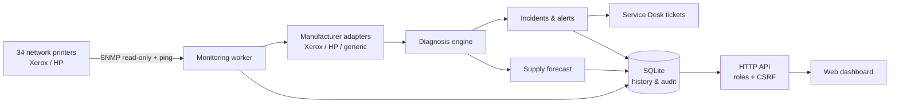

# NGSC PrintOps — Printer Monitoring & Operations Platform

A production printer-monitoring and operations platform I designed, built and deployed for the IT department of **New Giza Sports Club (NGSC)**, Egypt. It watches the club's full fleet of **34 network printers and MFPs** (Xerox and HP) and turns raw SNMP data into alerts, incidents, supply forecasts and Service Desk tickets.

> The source code is kept in a private repository because it contains the club's internal network details. This page describes the system, its design and what it does in production. Code walkthroughs are available on request.

**Status:** in production since October 2026 · 34 of 34 printers monitored · checks every 2 minutes · 270+ automated tests

---

## What it does

| Area | Features |
| --- | --- |
| Live monitoring | Read-only SNMP and ping checks every 2 minutes; online / offline / checking states with a verified-recovery rule, so one missed answer never raises a false alarm |
| Printer health | Toner, drum, fuser and waste-box levels, page counters and printer-reported errors (paper jam, open door, paper out), shown as the printer screen shows them |
| Alerts & incidents | Opened automatically from evidence, deduplicated per condition, and resolved only when a fresh reading proves the problem is gone; downtime recorded per incident |
| Forecasting | "Days left" and "pages left" per toner, worked out from each printer's own usage over 14 days |
| Supply inventory | Warehouse and office stock counts, reorder reminders, purchase requests and supplier calls |
| Service Desk tickets | Urgent tickets for empty toner or full waste boxes, sent to the club's Service Desk |
| Maintenance | Repair records, parts and costs, expected return dates and overdue alerts |
| Security | Sign-in with roles (viewer, IT support, IT manager, administrator), CSRF protection, login rate limiting, scrypt password hashing and a full audit log |
| Operations | Verified SQLite backups, health and readiness checks, and a worker lease so only one monitor runs at a time |

## How it works

- **Worker:** checks each authorized printer, normalizes its state and saves everything in one database transaction.
- **Diagnosis:** every conclusion is based on evidence. A failed ping alone never counts as "offline". A printer is marked offline only after three failed checks in a row, and marked back online only after two successful ones.
- **Safe onboarding:** a new printer is never polled until an IT manager explicitly authorizes it, and every authorization is audited.

## Built with

Node.js · SQLite · SNMP (Printer-MIB, Host-Resources-MIB) · HTML / JavaScript · Windows Server 2022 · VMware ESXi · Windows Scheduled Tasks · Node test runner

Developed with AI coding tools (Claude Code) under my direction: I set the requirements, validated every printer on the real network, and ran the deployment.

## Real-world validation

- Brought printers online one at a time: first a single Xerox WorkCentre 7835, then the full fleet in reviewed batches.
- Compared SNMP readings against each printer's own web interface: toner, drums, fuser, counters and alerts.
- Outage test: pulled a printer's network cable and confirmed it went offline, raised one alert and one incident, recovered and recorded the downtime.
- Tuned alert rules on real data to remove false alarms from printer start-up messages, empty bypass trays and unreadable supply chips.

## Author

**Mostafa Khalaf** — IT Help Desk Engineer / Junior Network Administrator, New Giza Sports Club
[sas8089@icloud.com](mailto:sas8089@icloud.com)
